<h1 align="center">Go2 RL Locomotion</h1>

<strong>From proprioceptive locomotion to blind obstacle traversal</strong>

Bhuvan Lakhera · Research with Deepan Muthirayan

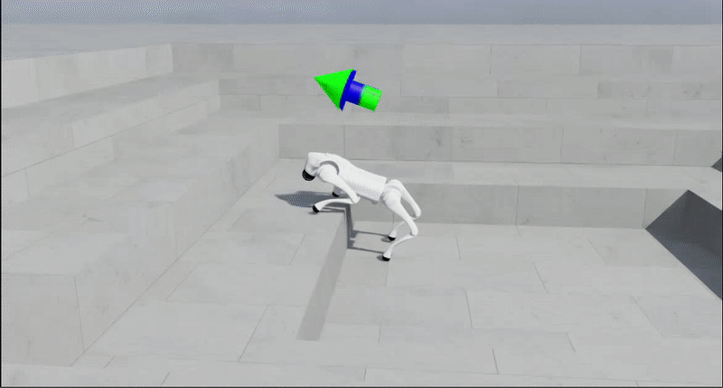

<em>Simulation playback in a configured 28 cm stair scene. This is a qualitative demonstration; the measured benchmark below covers 16–18 cm.</em>

[Simulation terrain](#watch-the-policy-in-simulation) · [Physical tests](#on-the-physical-go2) · [All 14 recordings](docs/media-gallery.md)

I built a staged reinforcement-learning pipeline to investigate how far a Unitree
Go2 can progress using proprioception alone. Starting with basic locomotion, I
worked through rough terrain, mixed locomotion tasks and higher obstacles. The
blind actor uses joint and body observations, velocity commands and motion history,
without a terrain-height map in its inputs.

My implementation spans Isaac Lab environments, PPO training, evaluation, policy
export and runtime integration. The work also includes physical robot experiments.
A later MuJoCo experiment highlighted another challenge: matching the exported
policy's outputs numerically was not enough to guarantee stable closed-loop
locomotion in a different physics simulator.

## The measured high-obstacle result

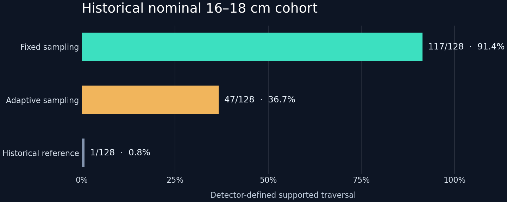

| Historical nominal simulation evaluation | Fixed-Mixture Policy | Adaptive-Frontier Policy | Pretrained Reference |
|---|---:|---:|---:|
| Combined 16–18 cm isolated steps / three-riser staircases | **117/128 · 91.4%** | 47/128 · 36.7% | 1/128 · 0.8% |
| Isolated 18 cm | **31/32** | 12/32 | 0/32 |
| Three-riser staircase 18 cm | **25/32** | 1/32 | 0/32 |

A policy trained using a fixed task mixture acquired substantially more complete
traversals than a policy trained using the specified adaptive task sampler in this
study. Task sampling allocated training experience; the learned actor does not
perform task sampling during locomotion. These counts come from the original
supported-traversal detector, one training seed per condition and two evaluation
seeds. The historical reference did not receive an equal continuation-training
budget. [Results and evaluation details](docs/results.md).

## How I developed the pipeline

| Stage | Engineering objective |
|---|---|
| **1 · Flat-ground locomotion** | Establish stable movement and velocity-command tracking |
| **2 · Rough-terrain adaptation** | Develop foot placement and body control on uneven surfaces |
| **3 · Generalist locomotion** | Combine terrain and stair tasks with ordinary movement commands |
| **4 · High-obstacle continuation** | Learn complete isolated-step and multi-riser traversal while retaining general locomotion |

Each stage posed a different problem. Moving near an obstacle was not enough;
the later evaluation needed to distinguish supported climbing from partial
footholds or a robot that simply remained upright. I also tracked ordinary
locomotion, so a climbing gain could be examined alongside changes in tracking,
action variation and effort proxies.

## Architecture and engineering

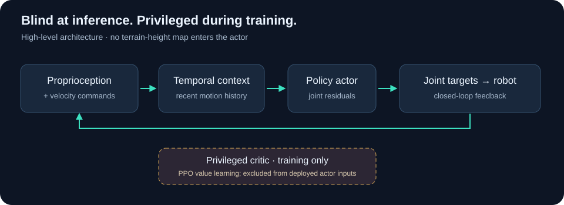

The temporal representation gives the actor context about recent motion. During
PPO training, an asymmetric critic receives privileged information that the actor
does not use at inference. I developed the staged simulation/training workflow,
evaluation and export interfaces around that separation.

Runtime integration brought another set of problems: observation packing, history
order, joint mapping, action scaling and position-target control. My work with
Unitree SDK2 and CycloneDDS involved an older **48-observation controller stack**;
that interface is separate from the later history-conditioned high-obstacle
system. [Architecture](docs/architecture.md) · [Training and media context](docs/methodology.md).

## Watch the policy in simulation

The **blind high-obstacle locomotion policy** across different terrain settings.
Click any preview for its full supplied recording.

<table>
<tr><td width="50%"><a href="media/recordings/rocky-stairs.mp4">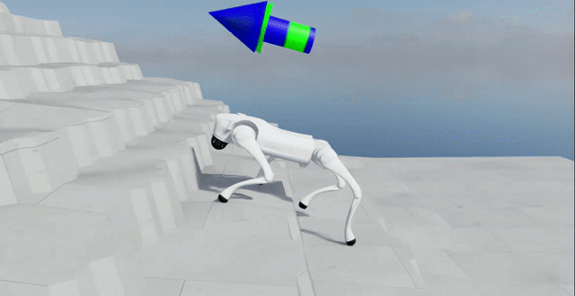</a> <strong>Rocky stairs</strong> Uneven treads, surface relief and changes of direction.</td><td width="50%"><a href="media/recordings/friction-tiles.mp4">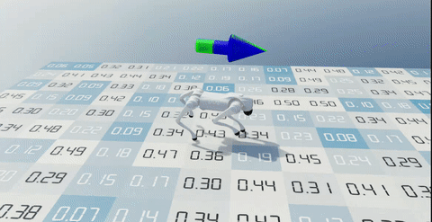</a> <strong>Friction variation</strong> Playback across a randomized friction-tile field.</td></tr>
<tr><td width="50%"><a href="media/recordings/separate-block-course.mp4">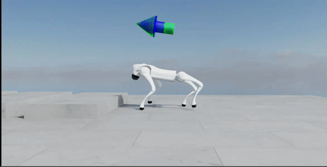</a> <strong>Separate-block course</strong> Raised blocks with ground between obstacles.</td><td width="50%"><a href="https://github.com/Bhuvanlakhera23/go2-obstacle-learning-rl/blob/main/media/pretrained-reference-stair-attempt.mp4">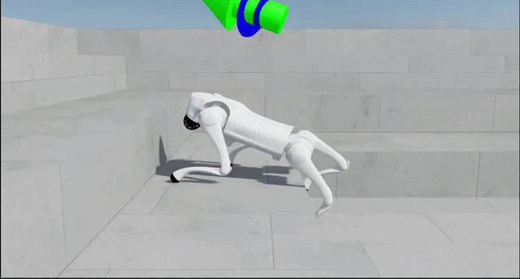</a> <strong>Historical reference</strong> Independent qualitative context; not a matched video trial.</td></tr>
</table>

The hero above shows a configured 28 cm stair scene:
[watch the full stair playback](media/recordings/staircase-playback.mp4).
These recordings are qualitative; the measured result remains the original
16–18 cm benchmark.

## On the physical Go2

Physical block, pad and panel tests, plus the response after a loss of support.
Tethers and handlers remain visible. These recordings are demonstrations, with
controller/checkpoint identities unverified; they add no benchmark episodes.

<table>
<tr><td width="50%"><a href="media/recordings/physical-block-take-2.mp4">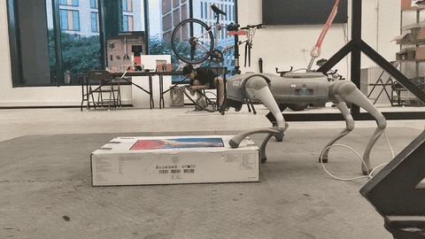</a> <strong>Block course</strong> Selected pass; the full recording retains the other approaches.</td><td width="50%"><a href="media/recordings/foam-pad-sequence-2.mp4">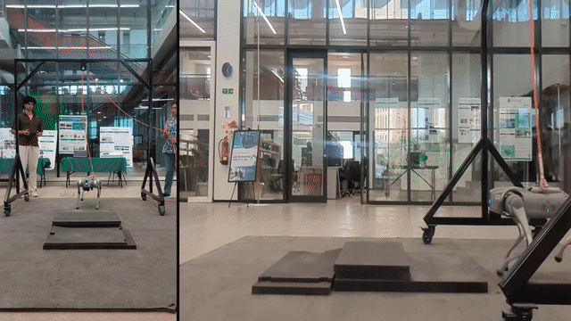</a> <strong>Foam-pad course</strong> Foot placement on pads that move and deform.</td></tr>
<tr><td width="50%"><a href="media/recordings/reflective-panel-take-2.mp4">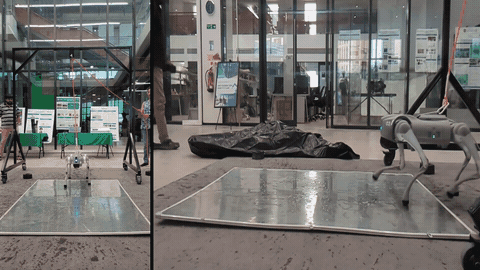</a> <strong>Reflective panel</strong> An additional supplied take; friction was not measured.</td><td width="50%"><a href="media/recordings/behavior-after-support-loss.mp4">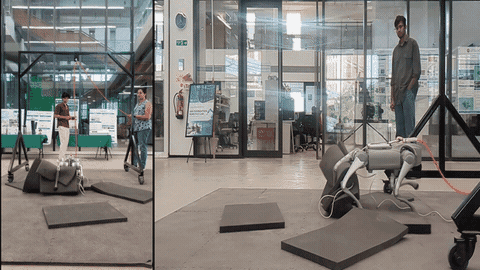</a> <strong>Behavior after loss of support</strong> Active leg/body motion; the sequence ends without self-righting.</td></tr>
</table>

**[Open the complete demonstration gallery](docs/media-gallery.md)** — all
**14 supplied gitmedia clips**, including the other panel and block takes,
longer pad sequences and physical locomotion. Some clips share events; this is a
recording collection, not 14 independent evaluation trials.

## What the experiments taught me

Harder-terrain exposure and learned climbing are different outcomes. The most
useful measure was completed traversal, considered together with ordinary
locomotion. For the policy trained using a fixed task mixture, acquisition gains
came with tracking and motion-cost trade-offs—one reason I treat retention as
part of the learning problem rather than a final check.

I investigate that question with **Deepan Muthirayan** in
[*Experience Allocation and Acquisition–Retention Trade-offs in Blind Quadruped
Obstacle Learning*](https://github.com/Bhuvanlakhera23/go2-obstacle-learning-rl).
The technical report explains the matched continuation experiment, exposure
records and per-task counterexamples. [Report v1.1.0](https://github.com/Bhuvanlakhera23/go2-obstacle-learning-rl/releases/tag/v1.1.0) ·
[Citation](CITATION.cff).

## Evaluation scope

The benchmark is a single-training-seed simulation study, not a hardware success
rate. Export equivalence passed only a fixed-batch-1 CPU protocol; closed-loop
MuJoCo walking failed its minimum-height criterion. Historical training-lineage
questions and hardware safety remain unresolved.
[Detailed limitations, including the retained parity and MuJoCo results](docs/limitations.md).
[Engineering case study: numerical parity and sim-to-sim transfer](docs/numerical-parity-and-sim-transfer.md).

## Code availability

The complete training implementation and trained policies are not publicly
distributed here. This repository focuses on demonstrations, measured results
and research documentation. [Media attribution and rights](docs/rights.md).
