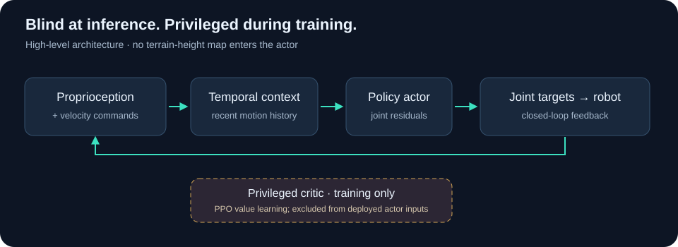

# How the locomotion system is organized

## Learning to act without a terrain map

The actor receives proprioceptive observations and velocity commands. Recent
motion history supplies temporal context: the policy can respond to how the body
and joints have been moving, rather than relying on a terrain-height map.
During PPO training, a separate critic uses privileged information to learn value
estimates. Those inputs are not added to the actor's deployed sensors.

## Building the training and evaluation workflow

I developed the Isaac Lab workflow across flat-ground locomotion, rough terrain,
generalist tasks and high-obstacle continuation. The later Foundation-02B study
changes how terrain-task exposure is allocated and measures both obstacle
acquisition and ordinary locomotion. The technical report gives the published
[methods and numerical comparison](https://github.com/Bhuvanlakhera23/go2-obstacle-learning-rl).

Evaluation distinguishes partial acquisition from full supported traversal.
Tracking errors, resets and motion-cost proxies provide additional views of the
policy; remaining upright or reaching a foothold is not automatically a climb.

## Export and controller interfaces

Export adds an interface contract: current observations, temporal history, joint
order, residual scale and default position must agree between training and runtime.
Numerical parity checks one part of that contract. Closed-loop behavior also
depends on observation construction, simulation dynamics and control timing.

I worked on joint mapping and position-target interfaces with Unitree SDK2 and
CycloneDDS. The earlier 48-observation deployment stack and the later temporal
Foundation-02B interface are distinct systems. Their results should not be
interchanged. See [runtime and safety limitations](limitations.md).
