# Demonstration gallery

**14 supplied recordings: 4 simulation clips and 10 physical clips.**
Every recording has a looping animated excerpt. Click a preview to open the
silent, full supplied video. Every original visible
frame is retained in those MP4s. Existing split-screen layouts, tethers and
handlers are preserved. The short animated previews on the [main page](../README.md)
are selected excerpts; the videos here keep the longer context.

**Preview paused?** In [GitHub accessibility settings](https://github.com/settings/accessibility),
set **Autoplay animated images → Enabled**, or open the linked MP4. GitHub may
otherwise follow your system’s reduced-motion preference.

[Simulation](#simulation) · [Block course](#physical-block-course) ·
[Panel tests](#reflective-panel-tests) · [Pad courses](#foam-pad-courses) ·
[Support-loss response](#behavior-after-loss-of-support) ·
[Physical locomotion](#physical-locomotion) · [Recording context](#recording-context)

## Simulation

The blind high-obstacle locomotion policy in four settings. Recording notes
identify a policy trained using a fixed task mixture. These are demonstrations,
not additional scored episodes.

<table>
<tr><td width="50%"><a href="../media/recordings/staircase-playback.mp4">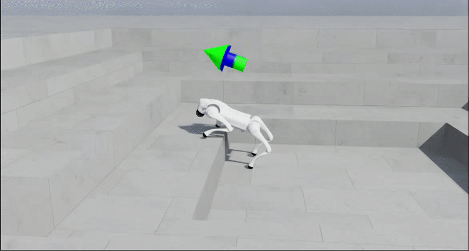</a> <strong>Staircase playback</strong> Configured 28 cm scene in the recording notes; qualitative playback. <a href="../media/recordings/staircase-playback.mp4">Watch / download MP4 · 111.30 s</a></td><td width="50%"><a href="../media/recordings/rocky-stairs.mp4">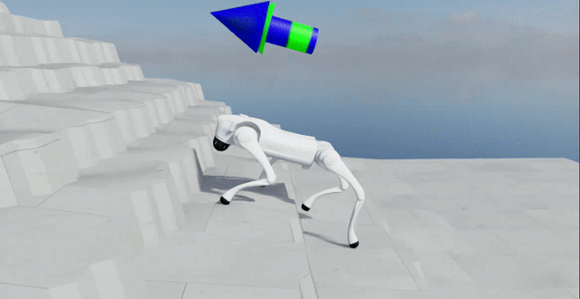</a> <strong>Rocky stairs</strong> Irregular stairs, uneven treads and surface relief. <a href="../media/recordings/rocky-stairs.mp4">Watch / download MP4 · 93.02 s</a></td></tr>
<tr><td width="50%"><a href="../media/recordings/friction-tiles.mp4">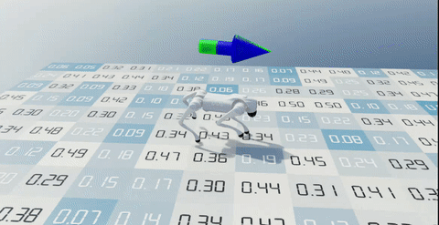</a> <strong>Friction-tile field</strong> Tiles with independently varied friction in the recording notes. <a href="../media/recordings/friction-tiles.mp4">Watch / download MP4 · 53.86 s</a></td><td width="50%"><a href="../media/recordings/separate-block-course.mp4">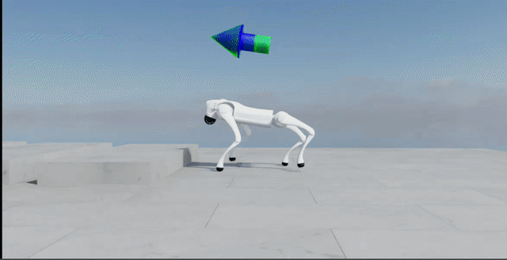</a> <strong>Separate-block course</strong> Blocks return to ground between obstacles; not a cumulative staircase. <a href="../media/recordings/separate-block-course.mp4">Watch / download MP4 · 43.41 s</a></td></tr>
</table>

## Physical block course

All three supplied block-course takes are available. The folder is labeled
15.5 cm, but no calibrated obstacle measurement or checkpoint identity is inferred
from that label. The main-page excerpt comes from take 2.

<table>
<tr><td width="50%"><a href="../media/recordings/physical-block-take-1.mp4">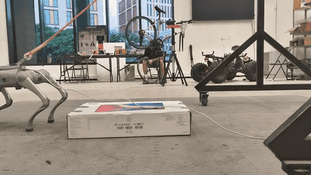</a> <strong>Block course · take 1</strong> Repeated approaches with tether and handler visible. <a href="../media/recordings/physical-block-take-1.mp4">Watch / download MP4 · 56.66 s</a></td><td width="50%"><a href="../media/recordings/physical-block-take-2.mp4">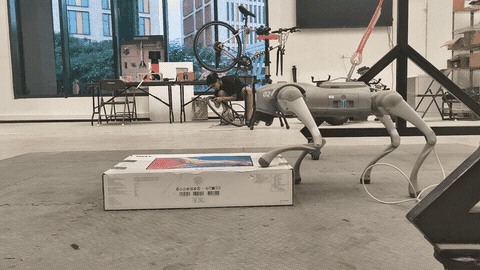</a> <strong>Block course · take 2</strong> The complete supplied recording behind the main-page block preview. <a href="../media/recordings/physical-block-take-2.mp4">Watch / download MP4 · 83.84 s</a></td></tr>
<tr><td width="50%"><a href="../media/recordings/physical-block-take-3.mp4">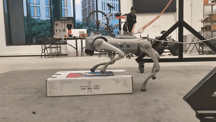</a> <strong>Block course · take 3</strong> Another supplied sequence of approaches and crossings. <a href="../media/recordings/physical-block-take-3.mp4">Watch / download MP4 · 38.08 s</a></td></tr>
</table>

## Reflective-panel tests

Three separate supplied takes, preserving their original split-screen layouts.
The surface appears reflective; these clips do not establish a friction coefficient
or a slippery-surface success rate.

<table>
<tr><td width="50%"> <strong>Reflective panel · take 1</strong> The take used in the earlier gallery excerpt. <a href="../media/recordings/reflective-panel-take-1.mp4">Watch / download MP4 · 11.90 s</a></td><td width="50%"><a href="../media/recordings/reflective-panel-take-2.mp4">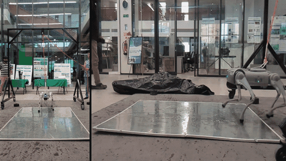</a> <strong>Reflective panel · take 2</strong> Additional crossing sequence, now also previewed on the main page. <a href="../media/recordings/reflective-panel-take-2.mp4">Watch / download MP4 · 14.30 s</a></td></tr>
<tr><td width="50%"><a href="../media/recordings/reflective-panel-take-3.mp4">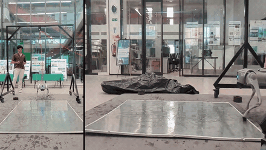</a> <strong>Reflective panel · take 3</strong> The third supplied take, retained in full. <a href="../media/recordings/reflective-panel-take-3.mp4">Watch / download MP4 · 7.85 s</a></td></tr>
</table>

## Foam-pad courses

Longer sequences show the movable pads and repeated approaches, rather than just
one pass. They include unsuccessful behavior; sequence 1 contains a fall.

<table>
<tr><td width="50%"><a href="../media/recordings/foam-pad-sequence-2.mp4">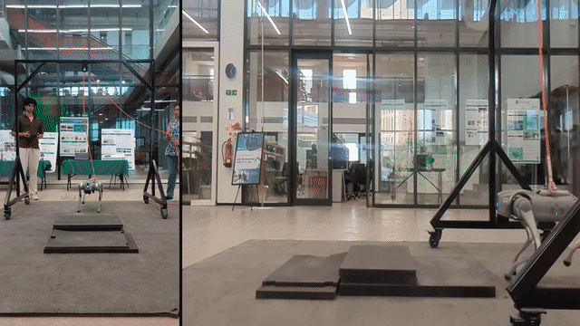</a> <strong>Pad course · sequence 2</strong> The complete supplied recording behind the main-page pad preview. <a href="../media/recordings/foam-pad-sequence-2.mp4">Watch / download MP4 · 56.80 s</a></td><td width="50%"><a href="../media/recordings/foam-pad-sequence-1.mp4">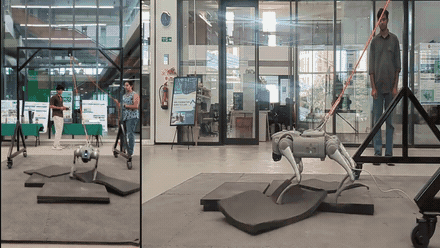</a> <strong>Pad course · sequence 1</strong> Additional sequence, including loss of footing and a fall. <a href="../media/recordings/foam-pad-sequence-1.mp4">Watch / download MP4 · 80.50 s</a></td></tr>
</table>

## Behavior after loss of support

[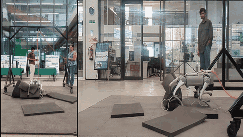](../media/recordings/behavior-after-support-loss.mp4)

The robot continues active leg/body motion after losing support, but does not
self-right before the clip ends. This is interesting behavior to inspect, not a
successful recovery claim. The supplied visual sequence is retained in full;
the shorter audio/container tail is omitted from the silent copy.

[Watch / download the complete supplied clip](../media/recordings/behavior-after-support-loss.mp4).

## Physical locomotion

 <strong>Physical Go2 locomotion</strong> The supplied locomotion recording, now available beyond the original short GIF. <a href="../media/recordings/physical-locomotion.mp4">Watch / download MP4 · 43.47 s</a>

## Historical reference

[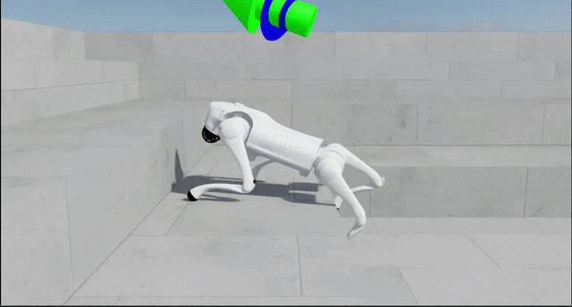](https://github.com/Bhuvanlakhera23/go2-obstacle-learning-rl/blob/main/media/pretrained-reference-stair-attempt.mp4)

The Model5099 reference is qualitative context for the climbing playback, not the
Adaptive-Frontier Policy or a matched-command video comparison.
[Previously published complete reference recording](https://github.com/Bhuvanlakhera23/go2-obstacle-learning-rl/blob/main/media/pretrained-reference-stair-attempt.mp4).
This reference is separate from the 14 supplied gitmedia clips above.

## Recording context

- MP4s retain the full **supplied visual timeline** at its original speed. Several
  source files were already trimmed or split-screen edited; this does not recover
  an original camera master or establish synchronization between views.
- Full videos are silent, resized H.264 copies for browser compatibility. No frame
  interpolation, view compositing, invented motion or new policy execution was
  used. Source and derivative identities are in the [expansion manifest](media-expansion-v1.json).
- Simulation geometry and command descriptions come from recording notes. They
  do not replace the frozen benchmark fixtures; some playback disables failure
  terminations. Observation noise does not reproduce hardware latency or dynamics.
- Hardware footage has no established exact controller/checkpoint or assistance
  record here. Tethering and handlers remain visible. Clips can overlap events;
  no success/failure rate is calculated from the collection.
- Earlier short GIFs and their [historical provenance](media-provenance.json) and
  [encoding record](media-optimization-v1.json) are unchanged. Historical
  filenames/identifiers remain in those records. New compact previews are
  documented in [preview provenance](media-preview-expansion-v1.json). The four newly animated
  gallery excerpts are documented in [playback fix provenance](media-playback-fix-v1.json).

[Original measured results](results.md) · [Scope and negative results](limitations.md) ·
[Experimental provenance](experimental-provenance.md) · [Media attribution](rights.md).
No training-stage identity, hardware safety qualification or new research result
is inferred from a selected recording. **approved_for_actuation: false**.
