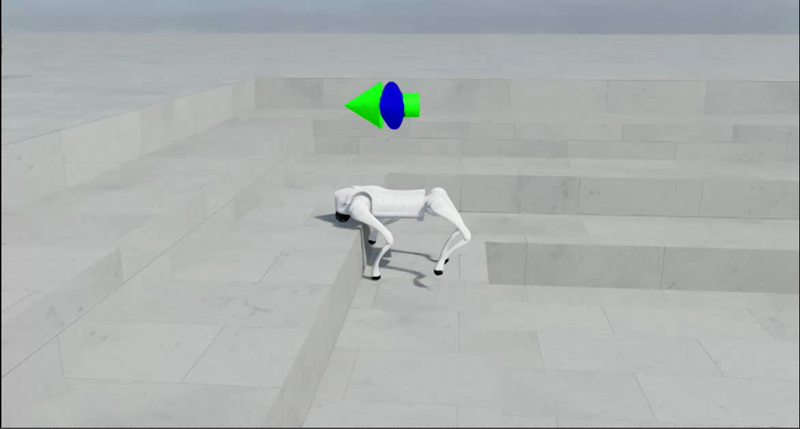
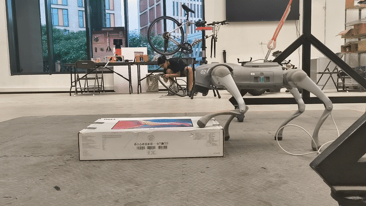
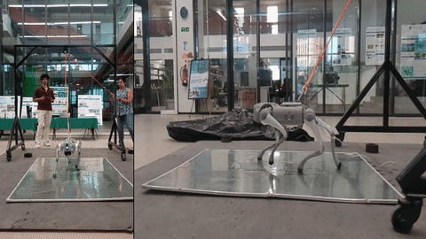
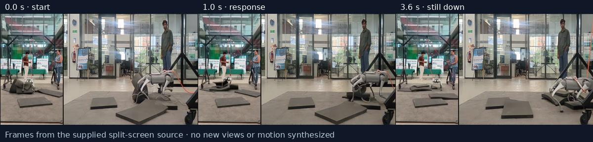
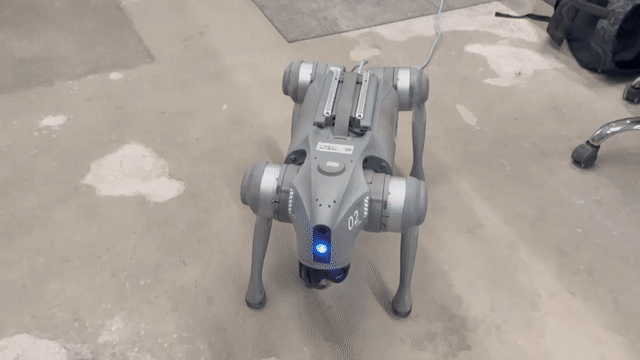

# Demonstration gallery

These are **selected demonstrations**, not complete evaluation timelines. Each
loop is a single continuous source excerpt at its original timeline speed; loops
return to the beginning. Original source hashes and excerpt positions are in the unchanged
[historical manifest](media-provenance.json); current GIF identities and encoding
results are in [optimization provenance](media-optimization-v1.json).

## Stairs · blind high-obstacle locomotion policy

Original 34–41 s excerpt. The exact original WebM hash matches the previously
approved report-media source. The public report identifies the demonstrated policy as trained using a fixed
task mixture, based on my identification, not checkpoint-to-video cryptographic proof. The described
28 cm setting is qualitative; it is not a measured supported-traversal benchmark.

[Previously published full recording](https://github.com/Bhuvanlakhera23/go2-obstacle-learning-rl/blob/main/media/fixed-mixture-stair-climb.mp4) ·
[Public media provenance and attribution](https://github.com/Bhuvanlakhera23/go2-obstacle-learning-rl/blob/main/media/README.md).
The full recording was separately converted for the existing public report; it
is not included in this repository. Its current binary playback availability
could not be rechecked from this environment.

A resized, uncropped source frame at 40 s. It is not a generated robot image or
a contact/traversal adjudication.

## Separate-block course · simulation

Original 5–12 s excerpt. My recording notes identify the blind high-obstacle locomotion policy endpoint
and describe increasing nominal obstacle heights, with ground between blocks.
Terminations were disabled: this is exploratory playback, not a scored run.
Exact scene-to-video and checkpoint-to-video binding are unverified.
The complete recording is not hosted in this repository.

## Rocky trail · simulation

Original 12–19 s excerpt. My recording notes describe variable stair dimensions, local
surface relief and teleoperation. Those notes are setup descriptions, not
measurements of the visible obstacle at each frame. This is later blind high-obstacle locomotion policy
footage, not proof of an earlier Stage 2 or generalist checkpoint.
The complete recording is not hosted here.

## Friction tiles · simulation

Original 5–12 s excerpt. My recording notes describe independently randomized friction
tiles and hardware-derived observation-noise approximations. Such noise does not
reproduce hardware latency, actuator dynamics or contact mechanics. No measured
friction-robustness success rate follows from this clip. The complete recording is not hosted here.

## Historical reference attempt · independent qualitative context

Original 46–53 s excerpt from the previously published historical reference
recording. The reference is identified by me as Model5099, **not the Adaptive-Frontier Policy**. It is not a matched-command or matched-condition counterpart to
the blind high-obstacle locomotion policy GIF, and is not presented as a full evaluation or failure rate.

[Previously published complete reference recording](https://github.com/Bhuvanlakhera23/go2-obstacle-learning-rl/blob/main/media/pretrained-reference-stair-attempt.mp4).
Its current binary playback availability was not independently rechecked.

## Physical Go2

### Physical block playback · added recording

Provided source 1.4–4.6 s excerpt from a different supplied block recording.
This is a selected pass from three recordings, not a summary of all attempts. The robot and its tether/handler are retained in
frame. The folder is labeled “15.5 cm step size,” but no calibrated measurement,
controller identity or assistance record is established. This is physical block
playback, not an independently adjudicated 15.5 cm benchmark or qualification of the research policy on
hardware. Times are relative to the supplied edited MP4, not an
asserted reconstruction of the original camera timeline.

### Foam-pad course · added split-screen recording

Provided source 5–9 s excerpt, tightened to show the pad motion rather than the idle lead-in. These split-screen views were already present in
the supplied recording; no views were stitched together here. Their time alignment
is unverified. Visible tethering and people remain in frame. It is a selected
motion example, not a complete trial or quantified pad-course success rate.

### Reflective panel · added split-screen recording

Provided source 2–8 s excerpt. The panel looks reflective; its friction is not
measured in the retained media evidence. Do not call this a quantified slippery-
surface test. Views are supplied split-screen edits with unverified synchronization.
The excerpt is not matched to the simulation friction-tile recording.

### Behavior after loss of support

All 3.733 s of the supplied **visual** timeline are represented at the original
speed, sampled to 15 fps for GIF display (3.72 s after GIF delay rounding). The source file's audio/container tail
is slightly longer; no recovery motion was removed. Loss of footing is followed
by active leg/body motion, and the clip ends with the robot still down. No
successful self-righting, unassisted recovery or recovery success rate is claimed.
The sequence does not identify the training mechanism behind this response. Tethering and the supplied split-screen views
remain visible; view synchronization and checkpoint identity are unverified.

These are timestamped source frames, not fabricated states or a stitched claim
of continuous motion. The complete recording is not hosted here.

### Original physical recording

Original 29–35 s excerpt from my physical recording collection. I confirmed
the required permissions for the selected first-party media and artifacts.
The recording's exact bytes duplicate a first-party deployed-policy video found
in the broader media search, but a duplicate hash alone does not establish a
checkpoint or controller identity. No high-step, command-tracking, quantitative
hardware performance or safety-qualification claim is made. The complete recording is not hosted here; the exact policy caption remains unresolved.

All newly added physical video sources were inspected. Three representative new
clips were selected to cover distinct settings without loading every take into
the README. Other supplied takes remain in the private inventory, including a pad
recording that visibly contains a fall. The chosen excerpts do not constitute a
complete evaluation or imply that failures were absent. Complete timelines remain
outside this repository; full recordings are not hosted here.

The 12 added analysis plots were also inspected. They show joint trajectories,
contact-pattern and loading displays, but no sealed mapping from their time axis,
underlying logs and selected video was established. They are inventoried rather
than used as new quantitative hardware evidence or copied as benchmark figures.
Editing-project files are retained only with the originals, not published here.

## Additional candidates reviewed, not selected

The broader first-party search also found directional before/after comparison
clips, a generic policy-play recording, two payload/high-step physical recordings,
a 12 cm native preview and an earlier rough-locomotion MuJoCo clip. These remain
in the private media inventory. They were not inserted as training-stage evidence:
policy identity, comparison semantics or relevance to this benchmark was not
sufficiently established. Third-party reference footage is never presented as this
project's result.

Missing: exact-checkpoint Stage 1 flat, Stage 2 rough and historical Stage 3
recordings. Useful future additions are **existing** recordings with an established
policy identity, a caption record and permission scope—not a request for new runs.
